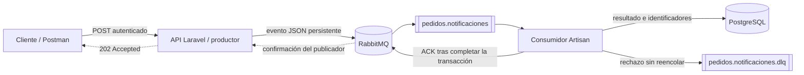
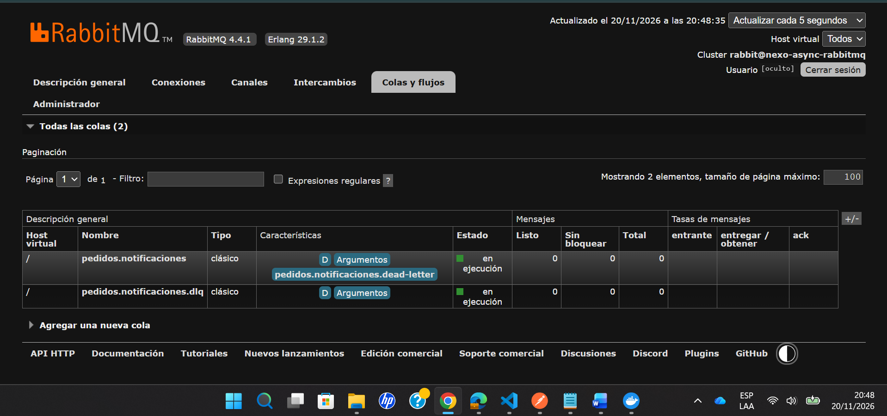
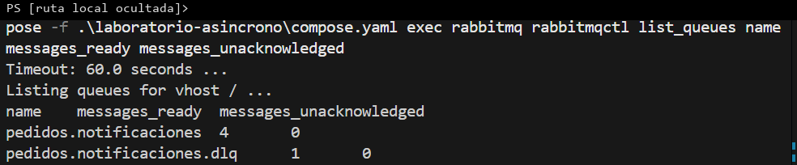
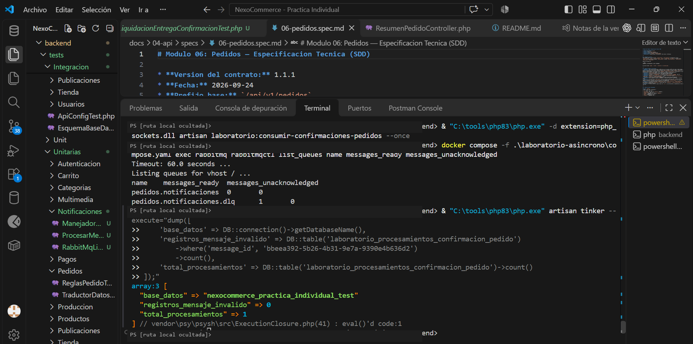
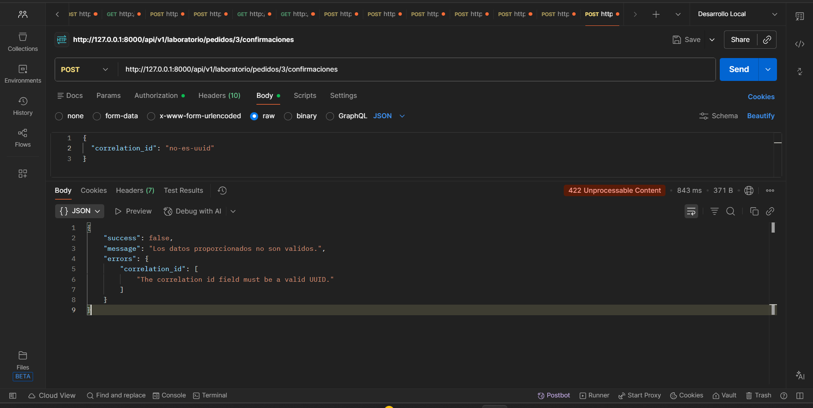
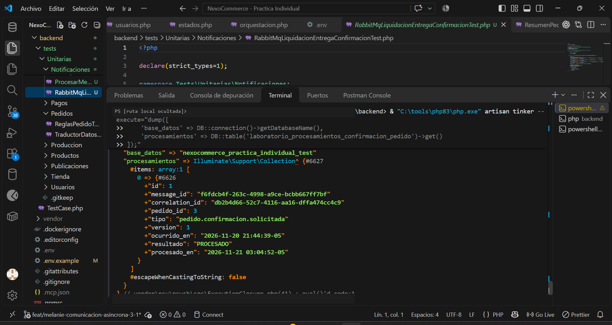
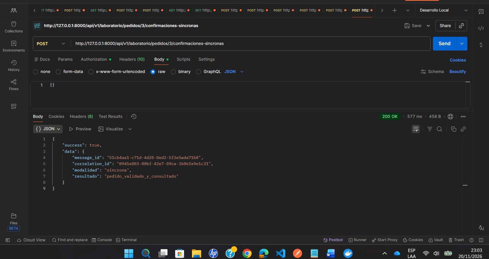

# Práctica individual 3.1 — Infraestructura de comunicación asíncrona

**Asignatura:** IS-803 — Integración e Implementación de Software
**Proyecto:** NexoCommerce
**Módulo:** Pedidos — confirmaciones asíncronas
**Rama individual:** `feat/melanie-comunicacion-asincrona-3-1`

Esta práctica implementa un productor Laravel, RabbitMQ y un consumidor Artisan independiente para procesar confirmaciones de pedidos. La respuesta `202 Accepted` significa que RabbitMQ confirmó la publicación; no significa que el consumidor ya terminó el procesamiento.

## 1. Proceso y arquitectura

La API autentica al cliente, verifica que el pedido le pertenezca y publica un evento en RabbitMQ. El consumidor independiente recibe el mensaje, valida el contrato, consulta el pedido y registra el resultado en PostgreSQL. La modalidad síncrona de laboratorio ejecuta la validación y consulta dentro de la solicitud HTTP para comparar latencias; no publica en RabbitMQ ni persiste un resultado.



`message_id` identifica cada mensaje y permite aplicar idempotencia. `correlation_id` permite seguir una solicitud desde la API hasta el resultado del consumidor.

## 2. Componentes

| Componente | Implementación |
|---|---|
| Productor | Endpoint Laravel que valida la solicitud y publica con confirmación del broker. |
| Broker | RabbitMQ ejecutado con el Compose independiente de `backend/laboratorio-asincrono/`. |
| Cola principal | `pedidos.notificaciones`, durable y para mensajes persistentes. |
| Cola de mensajes rechazados | `pedidos.notificaciones.dlq`, enlazada mediante la configuración de dead lettering. |
| Consumidor | `php artisan laboratorio:consumir-confirmaciones-pedidos`; admite `--once`. |
| Persistencia | Tabla `laboratorio_procesamientos_confirmacion_pedido`; `message_id` es único. |
| Comparación síncrona | Endpoint de laboratorio que valida y consulta sin usar RabbitMQ ni registrar el resultado. |

## 3. Contrato JSON

El evento publicado tiene esta forma:

```json
{
  "message_id": "UUID",
  "correlation_id": "UUID",
  "tipo": "pedido.confirmacion.solicitada",
  "version": 1,
  "ocurrido_en": "fecha ISO 8601",
  "payload": {
    "pedido_id": 22
  }
}
```

El cuerpo HTTP es opcional. Si se proporciona `correlation_id`, debe ser un UUID válido; si se omite, la aplicación genera uno. Ejemplo válido:

```json
{
  "correlation_id": "0208dd65-cd90-48d6-be1d-702dbd407603"
}
```

Un valor inválido produce `422 Unprocessable Content`:

```json
{
  "correlation_id": "no-es-uuid"
}
```

No se incluyen datos personales en el mensaje. Las capturas y ejemplos publicados tampoco deben contener tokens ni credenciales.

## 4. Ejecución local

Requisitos: PHP compatible con el proyecto, Composer, PostgreSQL, Docker Compose y la extensión `php_sockets` habilitada para AMQP. Utiliza únicamente una base de datos local de pruebas. No uses la base compartida del equipo.

Desde `backend`, iniciar y consultar la infraestructura:

```powershell
docker compose -f .\laboratorio-asincrono\compose.yaml up -d
docker compose -f .\laboratorio-asincrono\compose.yaml ps
docker compose -f .\laboratorio-asincrono\compose.yaml exec -T rabbitmq rabbitmq-diagnostics -q ping
docker compose -f .\laboratorio-asincrono\compose.yaml exec -T rabbitmq rabbitmqctl list_queues name messages_ready messages_unacknowledged
```

Configura localmente las variables `RABBITMQ_*` descritas en [`backend/.env.example`](../../backend/.env.example), sin versionar el archivo `.env` ni imprimir sus valores. Antes de aplicar la migración aditiva de la práctica, verifica que la conexión activa corresponde a la base exclusiva de pruebas.

Solicitudes de Postman, suponiendo que Laravel escucha en `127.0.0.1:8000` y que el usuario autenticado es CLIENTE propietario del pedido de prueba:

**Productor asíncrono**

```http
POST http://127.0.0.1:8000/api/v1/laboratorio/pedidos/3/confirmaciones
Authorization: Bearer <TOKEN_LOCAL>
Accept: application/json
Content-Type: application/json
```

**Comparación síncrona**

```http
POST http://127.0.0.1:8000/api/v1/laboratorio/pedidos/3/confirmaciones-sincronas
Authorization: Bearer <TOKEN_LOCAL>
Accept: application/json
Content-Type: application/json
```

Para consumir una entrega:

```powershell
& "C:\tools\php83\php.exe" -d extension=php_sockets.dll artisan laboratorio:consumir-confirmaciones-pedidos --once
```

La ruta de PHP depende del equipo. El pedido `3` es un dato local de prueba y puede no existir en otra instalación.

## 5. Pruebas y evidencias manuales

Las capturas se revisaron por su contenido y se copiaron con nombres descriptivos. En las copias de publicación se ocultaron el nombre de usuario de RabbitMQ y las rutas locales de Windows. Los archivos originales permanecen locales y no se incluyen en el commit.

### 5.1. Configuración visible de RabbitMQ

La interfaz muestra la cola durable `pedidos.notificaciones`, con argumento de dead lettering, y la cola durable `pedidos.notificaciones.dlq`. Ambas aparecen activas y vacías en el momento de la captura.



### 5.2. Publicación válida y HTTP 202

**No hay una captura de las imágenes recibidas que demuestre el `202 Accepted` del productor asíncrono.** La captura titulada originalmente como solicitud válida apunta a `confirmaciones-sincronas` y muestra `200 OK`; se utiliza en la comparación de la sección 6, no como evidencia del productor.

El informe previo registra una publicación asíncrona aceptada y procesada, pero las capturas proporcionadas no permiten comprobar por sí solas esa respuesta `202`. Para completar esta evidencia hace falta una captura de `POST /api/v1/laboratorio/pedidos/{id}/confirmaciones` donde se vea el estado `202` y la respuesta con identificadores, sin mostrar el token.

### 5.3. Mensajes pendientes con el consumidor detenido

La salida de `rabbitmqctl list_queues` muestra **4 mensajes listos y 0 sin ACK** en la cola principal, y **1 mensaje listo** en la DLQ. La captura acredita ese estado de las colas; no muestra directamente el estado del proceso consumidor, por lo que no prueba por sí sola que este estuviera detenido.



### 5.4. Ejecución del consumidor y procesamiento

La terminal muestra la invocación del comando Artisan con `--once`, seguida por el conteo de **0 mensajes listos** en la cola principal y **1 en la DLQ**. La misma sesión muestra una consulta de lectura con **1 procesamiento**, **0 registros para el mensaje inválido** y la base `nexocommerce_practica_individual_test`.



La captura muestra el comando y los estados posteriores, pero no captura una salida explícita de ACK del consumidor. El registro `PROCESADO` asociado a los identificadores se ve en la evidencia de PostgreSQL siguiente.

### 5.5. Mensaje inválido y respuesta HTTP 422

Postman muestra una solicitud con un `correlation_id` que no es UUID y una respuesta `422 Unprocessable Content`, con el error asociado a `errors.correlation_id`.



### 5.6. Correlación por `message_id` y `correlation_id`

La consulta de lectura muestra en la base de pruebas un registro con ambos identificadores, el pedido ficticio, el tipo de evento y resultado `PROCESADO`. Los UUID son identificadores de trazabilidad; no son credenciales.



### 5.7. Persistencia de resultados en PostgreSQL

La salida muestra que la consulta se realizó contra `nexocommerce_practica_individual_test`, con **1 procesamiento total** y **0 registros para el identificador del mensaje inválido**. La captura de correlación anterior muestra además el registro procesado con resultado `PROCESADO`.


La captura de consultas acredita los conteos observados; no demuestra por sí sola el ACK interno del canal AMQP. Tampoco acredita el número total de mensajes únicos de mediciones anteriores, porque la consulta visible se limita a un registro.

## 6. Comparación de latencia HTTP

| Indicador | Síncrona (laboratorio) | Asíncrona (productor) |
|---|---:|---:|
| Mediciones | 362, 395, 393 ms | 331, 698, 513 ms |
| Promedio | 383,33 ms | 514,00 ms |
| Mediana | 393 ms | 513 ms |
| Respuesta HTTP | `200 OK` al completar validación y consulta | `202 Accepted` tras confirmación del broker |
| Consumidor externo | No requerido | No requerido para aceptar publicaciones |

En esta muestra, la aceptación asíncrona tomó en promedio 130,67 ms más. Esto no demuestra que la arquitectura asíncrona sea más lenta en general: el productor espera una confirmación AMQP, mientras que el endpoint síncrono realiza una validación y consulta locales. No son mediciones equivalentes de extremo a extremo. Se comprobó el procesamiento posterior, pero no se midió su duración exacta desde la publicación.

La captura disponible para el endpoint síncrono muestra `200 OK`, una respuesta de modalidad `sincrona` y un tiempo de respuesta de 577 ms. No corresponde a las tres mediciones agregadas de la tabla y no se usa para recalcularlas.



## 7. Dificultad y solución

Se buscaba comprobar que los mensajes quedaran pendientes hasta que el consumidor los atendiera. La captura disponible muestra mensajes listos y sin ACK, y otra captura posterior muestra la cola principal vacía junto con un registro procesado. Las imágenes no muestran directamente el estado detenido del consumidor ni una respuesta `202`; esas limitaciones quedan señaladas arriba. La idempotencia se apoya en la restricción única de `message_id`.

## 8. Archivos relacionados

- Productor y contratos: `backend/app/Aplicacion/Notificaciones/` y los controladores y Request de `backend/app/Http/`.
- Consumidor: `backend/app/Console/Commands/ConsumirConfirmacionesPedidosCommand.php` y `backend/app/Infraestructura/Servicios/RabbitMqConfirmacionPedidoConsumer.php`.
- RabbitMQ: `backend/laboratorio-asincrono/`.
- Persistencia: migración, modelo y repositorio de `backend/` para `laboratorio_procesamientos_confirmacion_pedido`.
- Comparación síncrona: `ConfirmacionPedidoSincronaController.php` y su caso de uso.
- Pruebas: `backend/tests/Integracion/Notificaciones/` y `backend/tests/Unitarias/Notificaciones/`.

## 9. Publicación del repositorio

Antes de compartir el repositorio, verifica el commit, el push y el acceso al enlace. No publiques `.env`, tokens, claves, bases de datos locales, logs, `vendor/`, `node_modules/` ni configuraciones personales de herramientas.
